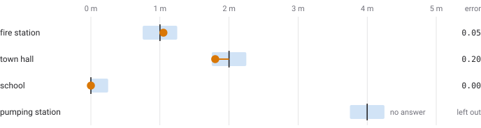
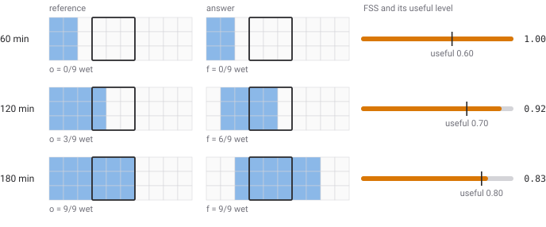

# delta-agent-evals

[](https://github.com/delta-agents/delta-agent-evals/actions/workflows/tests.yaml)
[](https://delta-agents.github.io/delta-agent-evals/)
[](https://www.python.org)
[](LICENSE)

**delta-agent-evals** tests artificial intelligence (AI) agents the way water and weather science
tests its models. An agent's answer is the forecast, the reference answer the observation, and any
metric of [scores](https://github.com/nci/scores) compares the two over a dataset of questions run
with [pydantic-evals](https://ai.pydantic.dev/evals/). One function, `verify`, does it for a number,
a yes or no, a probability, an ensemble or a map per lead time.

*delta-agent-evals is developed by [HKV lijn in water](https://www.hkv.nl) for
[Delta Agents](https://delta-agents.nl).*

## Documentation

See the [documentation site](https://delta-agents.github.io/delta-agent-evals/): one page per kind
of measure, each with an interactive figure that shows how the measure comes about. For language
models it is also there as [llms.txt](https://delta-agents.github.io/delta-agent-evals/llms.txt) and
[llms-full.txt](https://delta-agents.github.io/delta-agent-evals/llms-full.txt).

## Example

Four questions about the water depth if a dike breaches, an agent that answers three of them, and the
mean absolute error, the root mean squared error and how often an answer is within a tolerance:

```python
from pydantic_evals import Case, Dataset
from scores.continuous import mae, percent_within_x, rmse

from delta_agent_evals import each, verify

# the questions as text, with the reference answer: the water depth in metres
depths = {"fire station": 1.0, "town hall": 2.0, "school": 0.0, "pumping station": 4.0}
dataset = Dataset(
    name="depth",
    cases=[
        Case(inputs=f"If dike ring 52 breaches, how deep is the water at the {p}?", expected_output=d)
        for p, d in depths.items()
    ],
)


# the agent: here one with known answers, and none for the pumping station
async def agent(question: str) -> float | None:
    answers = {"fire station": 1.05, "town hall": 1.8, "school": 0.0}
    return next((d for p, d in answers.items() if p in question), None)


report = dataset.evaluate_sync(agent, progress=False)
errors = verify(None, mae, rmse).on(report)  # mae 0.083, rmse 0.119; the missing answer is left out
hits = verify(None, percent_within_x, threshold=each(0.1, 0.25, 0.5)).on(report)  # 67%, 100%, 100%
```

<picture>
  <source media="(prefers-color-scheme: dark)" srcset="images/errors-dark.svg">
  
</picture>

Answers can have dimensions of their own. A map per lead time, a `Grid`, gets the Fractions Skill
Score of `scores` per lead time, the level from which it is useful, and the skillful lead time. Over a
wider window, a map that is a little off counts as useful for longer:

```python
from delta_agent_evals import each, fss, verify

# maps: questions answered with a map per hour, as in examples/spatial_fss.py
skill = verify(None, fss, event_threshold=0.5, window_size=each(1, 3)).on(maps)
skill["skillful_lead_time"]  # 120 min per 25 m pixel, 180 min over 75 m
```

<picture>
  <source media="(prefers-color-scheme: dark)" srcset="images/maps-dark.svg">
  
</picture>

## Features

- Any metric of `scores` on the answers of a pydantic-evals report, through one function: `verify`.
- Answers as a number, a yes or no, a probability, or with dimensions of their own: `Grid`,
  `Ensemble` and `Series`, or anything with `to_xarray()`.
- Ratios pooled over all questions, never averaged per question; a missing answer is left out and
  counted per agent.
- Repeated runs as an ensemble, and options swept with `each(...)`.
- Agents side by side, with a skill score against a reference and a paired bootstrap.
- How readers take an answer: probability words such as "likely" per reader (`PHRASES`), and water
  terms that most laypeople misread (`Jargon`), also on live traffic.
- One result, a `Verification`: an xarray Dataset, a tidy table and an
  [Observable Plot](https://observablehq.com/plot/) figure; also a pydantic-evals report evaluator.

| Measure | Example | Use case |
|---|---|---|
| [Continuous errors](https://delta-agents.github.io/delta-agent-evals/example/continuous-errors/) | [continuous_errors.py](examples/continuous_errors.py) | How deep will the water be? |
| [Yes or no](https://delta-agents.github.io/delta-agent-evals/example/yes-or-no/) | [yes_or_no.py](examples/yes_or_no.py) | Will it flood? |
| [Maps](https://delta-agents.github.io/delta-agent-evals/example/maps/) | [spatial_fss.py](examples/spatial_fss.py) | Where is the water, every hour? |
| [Ensembles](https://delta-agents.github.io/delta-agent-evals/example/ensembles/) | [ensembles.py](examples/ensembles.py) | What will the water level be? |
| [Skill and significance](https://delta-agents.github.io/delta-agent-evals/example/skill-and-significance/) | [skill_and_significance.py](examples/skill_and_significance.py) | Better than without tools? |
| [Probability words](https://delta-agents.github.io/delta-agent-evals/example/probability-words/) | [probability_words.py](examples/probability_words.py) | How likely is it to flood? |
| [Plain language](https://delta-agents.github.io/delta-agent-evals/example/plain-language/) | [plain_language.py](examples/plain_language.py) | Do people understand the answer? |

## Installation

```bash
pip install git+https://github.com/delta-agents/delta-agent-evals
```

With [uv](https://docs.astral.sh/uv/), and with the `plot` extra for figures:

```bash
uv add "delta-agent-evals[plot] @ git+https://github.com/delta-agents/delta-agent-evals"
```

## Getting help

For questions, bugs and ideas, please open a
[GitHub issue](https://github.com/delta-agents/delta-agent-evals/issues).

## Development

[](https://github.com/astral-sh/uv)
[](https://github.com/astral-sh/ruff)

See [Contributing](https://delta-agents.github.io/delta-agent-evals/contributing/) and
[CLAUDE.md](CLAUDE.md) for the commands and the conventions.

## Built on

delta-agent-evals stands on [scores](https://github.com/nci/scores) (Leeuwenburg et al. 2024,
<https://doi.org/10.21105/joss.06889>) for every metric and on
[pydantic-evals](https://ai.pydantic.dev/evals/) for running the questions. The checks on how readers
take an answer come from Willems, Albers & Smeets (2020, <https://doi.org/10.22323/2.19020203>) and
Venhuizen et al. (2019, <https://doi.org/10.5194/hess-23-393-2019>); the useful level of the
Fractions Skill Score from Roberts & Lean (2008, <https://doi.org/10.1175/2007MWR2123.1>).

## Licence

GNU General Public License (GPL) 3.0, [HKV lijn in water](https://www.hkv.nl). The figure in
[docs/probability-phrases.md](docs/probability-phrases.md) is Creative Commons
Attribution-NonCommercial-NoDerivatives (CC BY-NC-ND) 4.0 by its authors.
