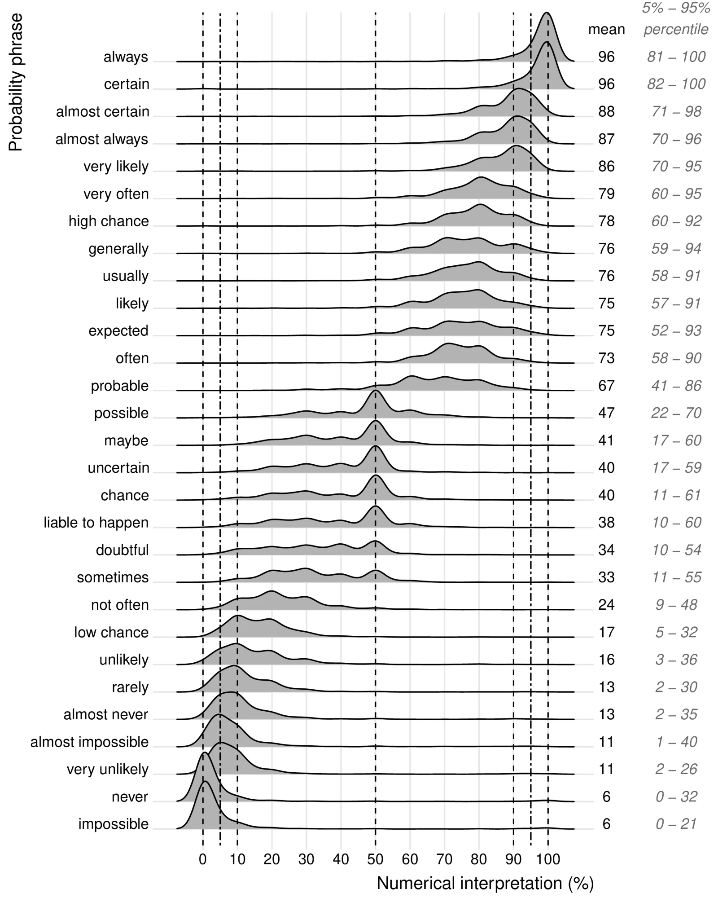

# How people read probability words

An agent that answers "the fire station will **likely** flood" gives a forecast in words. How
likely is likely? 881 Dutch readers, statisticians among them, put 29 probability words on a
0–100% scale. The extremes ("certain", "impossible") they agree on; in the middle they do not.
"Possible" ranges from 22% to 70%, and "likely" from 57% to 91%.

*Figure 2 from Willems, S. J. W., Albers, C. J., & Smeets, I. (2020). Variability in the
interpretation of probability phrases used in Dutch news articles — a risk for miscommunication.
Journal of Science Communication, 19(02), A03. <https://doi.org/10.22323/2.19020203>. © The
authors, licensed under [CC BY-NC-ND 4.0](https://creativecommons.org/licenses/by-nc-nd/4.0/):
shared unchanged, for non-commercial use. The figure is not covered by this repository's GPL.*

The readers saw the Dutch words; the figure gives the paper's English translations. The authors
advise giving a number, or a word with a number, rather than a word alone.

## The numbers

Mean and 5%–95% range of the readings in percent, read from the figure, with the Dutch words
the readers saw (the paper's Table 2). The same table is `delta_agent_evals.PHRASES`, by Dutch or
English word, and a test keeps this table equal to it; [verbal_forecast.py](../examples/verbal_forecast.py)
scores an agent's words with it.

| Dutch | English | Mean | 5%–95% |
|---|---|---|---|
| altijd | always | 96 | 81–100 |
| zeker | certain | 96 | 82–100 |
| bijna zeker | almost certain | 88 | 71–98 |
| bijna altijd | almost always | 87 | 70–96 |
| zeer waarschijnlijk | very likely | 86 | 70–95 |
| heel vaak | very often | 79 | 60–95 |
| grote kans | high chance | 78 | 60–92 |
| doorgaans | generally | 76 | 59–94 |
| meestal | usually | 76 | 58–91 |
| waarschijnlijk | likely | 75 | 57–91 |
| te verwachten | expected | 75 | 52–93 |
| vaak | often | 73 | 58–90 |
| vermoedelijk | probable | 67 | 41–86 |
| mogelijk | possible | 47 | 22–70 |
| misschien | maybe | 41 | 17–60 |
| onzeker | uncertain | 40 | 17–59 |
| kans | chance | 40 | 11–61 |
| kan gebeuren | liable to happen | 38 | 10–60 |
| twijfelachtig | doubtful | 34 | 10–54 |
| soms | sometimes | 33 | 11–55 |
| niet vaak | not often | 24 | 9–48 |
| kleine kans | low chance | 17 | 5–32 |
| onwaarschijnlijk | unlikely | 16 | 3–36 |
| zelden | rarely | 13 | 2–30 |
| bijna nooit | almost never | 13 | 2–35 |
| bijna onmogelijk | almost impossible | 11 | 1–40 |
| zeer onwaarschijnlijk | very unlikely | 11 | 2–26 |
| nooit | never | 6 | 0–32 |
| onmogelijk | impossible | 6 | 0–21 |
